# Master Implementation Plan & System Architecture

**Project**: Quantix Service Request & Approval Platform  
**Target Window**: 2-Day Submission Window (~15 Hours Backend Effort + ~7 Hours Optional React Frontend)  
**Target Roles**: Employee, Manager, Operations User  
**Primary Tech Stack**: Laravel 11+, PHP 8.2+, MySQL 8.0, Laravel Sanctum, Pest/PHPUnit, React 18, TypeScript, Tailwind CSS  

---

## 1. Development Environment Inspection

An exhaustive environment inspection was executed in the workspace (`C:\Users\IAGZ\Desktop\Internship Project Bhashitha`):

| Component / Tool | Detected Status / Version | Action Required |
| :--- | :--- | :--- |
| **Workspace Contents** | Only `Quantix_SE_Internship_Take_Home_Assignment.pdf` exists. | Fresh repository setup required. |
| **Existing Laravel Project** | None present. | Initialize clean Laravel 11 application. |
| **Existing React Project** | None present. | Initialize Vite + React 18 + TypeScript SPA in `client/` folder. |
| **PHP Version** | `PHP 8.5.12 (cli) (ZTS Visual C++ 2022 x64)` | Fully meets and exceeds `PHP 8.2+` requirement. |
| **PHP Extensions** | `pdo`, `pdo_mysql`, `openssl`, `mbstring`, `curl`, `json`, `bcmath`, `fileinfo` are active. | Ready for MySQL ORM operations. |
| **Composer Version** | `Composer 2.10.3` | Up-to-date; ready for dependency management. |
| **Node.js Version** | `v24.22.0` | Up-to-date LTS; ready for frontend build tools. |
| **npm Version** | `11.19.1` | Up-to-date; ready for client package installation. |
| **Database Server** | Local Windows service `MySQL80` is active and `Running`. | Use MySQL 8.0 on `127.0.0.1:3306` with database `quantix_requests`. |
| **Version Control** | `git version 2.56.0.windows.2` installed; repository not yet initialized. | Initialize `git init`, set up `.gitignore`, and structure commit history. |

---

## 2. System Architecture Overview

The system architecture follows a **Modular Monolith with a Service Layer** on the Laravel backend and a decoupled **Vite + React SPA** on the frontend.

```mermaid
graph LR
    subgraph Frontend["Frontend SPA (React 18 + Vite + TS)"]
        UI[Tailwind UI Views]
        RQuery[TanStack React Query]
        AxiosClient[Axios API Client]
        UI --> RQuery --> AxiosClient
    end

    subgraph BackendAPI["Backend Modular Monolith (Laravel 11+)"]
        API[API Routes /routes/api.php]
        Sanctum[Sanctum Auth Guard]
        FormReq[Form Requests Validation]
        Policies[RBAC & Policy Guard]
        Controllers[API Controllers]
        Services[Service Layer & State Machine]
        DBQueue[Async Notification Queue]
        Models[Eloquent Models]

        API --> Sanctum --> FormReq --> Policies --> Controllers --> Services
        Services --> DBQueue
        Services --> Models
    end

    subgraph Storage["Persistence Layer"]
        MySQL[(MySQL 8.0 Database)]
        Models --> MySQL
        DBQueue --> MySQL
    end

    AxiosClient -->|JSON / Bearer Token| API
```



### 2.1. Responsibilities of Architectural Components

1. **Routing Layer (`routes/api.php`)**: Clean RESTful routes protected by `auth:sanctum` and role middleware.
2. **Form Request Layer (`app/Http/Requests/*`)**: Validates inbound parameters, prevents bad payloads from hitting business logic, and returns standardized `422 Unprocessable Entity` responses.
3. **Authorization Layer (`app/Policies/*`)**: Declarative rules enforcing who can view, edit, submit, decide, assign, or comment on any given service request.
4. **Service Layer (`app/Services/*`)**: Encapsulates business logic, database transactions (`DB::transaction`), and cross-cutting concerns (audit logging and notification dispatch).
5. **State Machine (`app/Services/WorkflowEngine/RequestStateMachine.php`)**: Single source of truth for the request lifecycle, ensuring requests only move through sanctioned status transitions.
6. **Asynchronous Queue & Notifications (`app/Notifications/*`)**: Background queue processing for event-driven notifications to prevent blocking HTTP response cycles.
7. **Eloquent ORM (`app/Models/*`)**: Type-safe data models and relationship bindings (`User`, `ServiceRequest`, `RequestComment`, `RequestActivity`).
8. **API Resources (`app/Http/Resources/*`)**: Data transformation layer ensuring all API responses conform to predictable JSON schemas.

---

## 3. Database Architecture Summary

The complete relational schema and DDL are documented in [`docs/DATABASE_DESIGN.md`](file:///c:/Users/IAGZ/Desktop/Internship%20Project%20Bhashitha/docs/DATABASE_DESIGN.md).

### Key Highlights:
- **`users` Table**: Supports direct manager relationships through `manager_id` (foreign key referencing `users.id` with `ON DELETE SET NULL`). Includes `role` enum (`employee`, `manager`, `operations`).
- **`service_requests` Table**: Distinct foreign keys for `requester_id` (Employee) and `assigned_to_id` (Operations User). Includes unique `request_number` (e.g. `REQ-202611-0001`), `category`, `title`, `description`, `priority`, `status`, and SLA timestamp tracking.
- **`request_comments` Table**: Threaded discussion messages linked to `service_request_id` and authored by `user_id`.
- **`request_activities` Table**: Immutable audit log capturing every state transition, actor, old/new status, timestamp, and transition comment.
- **`notifications` Table**: Standard Laravel database notifications table for tracking in-app alerts.

---

## 4. RESTful API Contract Summary

The complete endpoint specifications, JSON request/response envelopes, and error codes are documented in [`docs/API_DESIGN.md`](file:///c:/Users/IAGZ/Desktop/Internship%20Project%20Bhashitha/docs/API_DESIGN.md).

### Core Endpoints Matrix:

| HTTP Method | Endpoint | Allowed Role | Primary Purpose |
| :--- | :--- | :--- | :--- |
| `POST` | `/api/login` | Public (Any) | Authenticates credentials and issues Sanctum access token |
| `POST` | `/api/logout` | Authenticated | Revokes current Sanctum token |
| `GET` | `/api/me` | Authenticated | Returns current profile and direct manager info |
| `POST` | `/api/requests` | Employee | Creates a request as `draft` or directly `submitted` |
| `GET` | `/api/requests` | All Authenticated | Role-scoped list with search, status filtering, sorting, pagination |
| `GET` | `/api/requests/{id}` | All (Policy Guarded) | Full detail view with comments and audit activity history |
| `PUT` | `/api/requests/{id}` | Employee (Owner) | Updates details of a `draft` or `returned` request |
| `POST` | `/api/requests/{id}/submit` | Employee (Owner) | Submits draft or re-submits returned request for review |
| `POST` | `/api/requests/{id}/decision` | Manager (Direct) | Approves, rejects, or returns request with mandatory comment |
| `POST` | `/api/requests/{id}/assign` | Operations | Assigns an operations team owner to the request |
| `POST` | `/api/requests/{id}/status` | Operations | Moves request status to `in_progress` or `completed` |
| `POST` | `/api/requests/{id}/comments`| Participants | Appends a comment to the request conversation |
| `GET` | `/api/notifications` | Authenticated | Fetches in-app status notifications |
| `PATCH` | `/api/notifications/{id}/read`| Authenticated | Marks notification as read |

---

## 5. React Frontend Architecture & Design

### 5.1. Directory Structure (`client/`)
```
client/
├── public/
├── src/
│   ├── api/
│   │   ├── client.ts             # Axios instance with auth interceptor
│   │   ├── auth.ts               # Login, logout, getMe
│   │   ├── requests.ts           # CRUD, transitions, assign, decision
│   │   └── notifications.ts      # List notifications, mark read
│   ├── components/
│   │   ├── common/
│   │   │   ├── Button.tsx        # Variants: primary, secondary, danger, ghost
│   │   │   ├── Input.tsx         # Standard input with error text
│   │   │   ├── Textarea.tsx      # Standard multiline input
│   │   │   ├── Select.tsx        # Styled dropdown
│   │   │   ├── StatusBadge.tsx   # Color-coded workflow badges
│   │   │   ├── PriorityBadge.tsx # Low / Med / High / Urgent badges
│   │   │   ├── Modal.tsx         # Accessible overlay modal
│   │   │   ├── Pagination.tsx    # Page navigation controls
│   │   │   └── Spinner.tsx       # Loading indicators
│   │   ├── layout/
│   │   │   ├── AppLayout.tsx     # Shell with Navbar, Sidebar, Content
│   │   │   ├── Navbar.tsx        # User profile, role badge, quick switcher
│   │   │   ├── Sidebar.tsx       # Role-aware navigation links
│   │   │   └── NotificationBell.tsx # Dropdown notification drawer
│   │   └── requests/
│   │       ├── RequestTable.tsx      # Filterable, sortable requests table
│   │       ├── ActivityTimeline.tsx  # Chronological visual audit trail
│   │       ├── CommentSection.tsx    # Discussion feed with reply box
│   │       ├── ManagerDecisionModal.tsx # Approve / Reject / Return modal
│   │       └── AssignOwnerModal.tsx  # Operations team assign modal
│   ├── context/
│   │   └── AuthContext.tsx       # Global auth state, user, token, login/logout
│   ├── hooks/
│   │   ├── useAuth.ts            # Consumes AuthContext
│   │   └── useNotifications.ts   # Polling / TanStack query for alerts
│   ├── pages/
│   │   ├── LoginPage.tsx         # Login view with 1-click demo user credentials
│   │   ├── DashboardPage.tsx     # Role-specific dashboard metrics & alerts
│   │   ├── RequestsListPage.tsx  # Main requests index view
│   │   ├── RequestDetailPage.tsx # Detail view with tabs (Details, Timeline, Comments)
│   │   └── CreateRequestPage.tsx # Request creation & editing form
│   ├── types/
│   │   └── index.ts              # TypeScript interfaces (User, Request, Activity, Comment)
│   ├── App.tsx                   # Route definitions and query client provider
│   ├── index.css                 # Tailwind directives
│   └── main.tsx                  # React DOM entry point
├── package.json
├── tsconfig.json
├── tailwind.config.js
└── vite.config.ts
```

### 5.2. Route Architecture
- `/login`: Public login page with quick-fill credentials for reviewer convenience (Alice, Sarah, Oscar).
- `/`: Protected home / dashboard routing automatically to role-tailored view.
- `/requests`: Filterable list of requests scoped to user role.
- `/requests/new`: Form to create a draft or submitted request (Employee only).
- `/requests/:id`: Detailed view of a request, including status timeline, comment feed, and role-specific action buttons.
- `/requests/:id/edit`: Edit form for requests in `draft` or `returned` status (Employee only).

### 5.3. Authentication Handling
- Access tokens stored in `localStorage` under `quantix_token`.
- Axios interceptor automatically attaches `Authorization: Bearer <token>` to outbound requests.
- Response interceptor catches `401 Unauthorized` and dispatches clean session logout.
- `AuthContext` provides `user`, `role`, `login`, `logout`, and boolean helpers (`isEmployee`, `isManager`, `isOperations`).

### 5.4. Role-Specific UX Workflows
1. **Employee View**:
   - High-visibility notification banner if any requests are in `returned` status requiring action.
   - Distinct "Save Draft" vs "Submit for Review" primary buttons.
   - Read-only locking on fields once submitted.
2. **Manager View**:
   - Filter tab dedicated to "Pending My Approval".
   - Contextual Action Modal with three clear paths:
     - **Approve**: Green highlight, optional note.
     - **Reject**: Red highlight, optional reason.
     - **Return**: Amber highlight, **strictly mandatory reason textarea**.
3. **Operations View**:
   - Kanban-style or segmented tab queues: "Needs Assignment", "In Progress", "Completed".
   - Quick "Assign to Me" or assign to another Operations teammate dropdown.
   - Status transition buttons (`Start Working`, `Mark Completed`).

---

## 6. Development Roadmap & Milestones

The detailed breakdown of files, tasks, dependencies, and risks is documented in [`docs/DEVELOPMENT_ROADMAP.md`](file:///c:/Users/IAGZ/Desktop/Internship%20Project%20Bhashitha/docs/DEVELOPMENT_ROADMAP.md).

```
Milestone 1: Backend Architecture & Implementation (~15 Hours)
├── Phase 1: Environment & Project Foundation Setup
├── Phase 2: Domain Modeling, Schema Migrations & Database Seeders
├── Phase 3: Sanctum Token Authentication, RBAC & Policies
├── Phase 4: Workflow Engine, State Machine & RESTful API Controllers
├── Phase 5: Async Queues, Activity Logging & Notifications
└── Phase 6: Automated Testing Suite (Pest/PHPUnit) & Quality Assurance

Milestone 2: React Frontend Application (~7 Hours)
├── Phase 7: React SPA Initialization, Tailwind Design System & Client Setup
├── Phase 8: Role Dashboards, Action Modals, Timelines & Comment Feeds
└── Phase 9: End-to-End Verification, OpenAPI Specs & Deliverables
```

---

## 7. Ambiguities, Decisions, and Assumptions

To maintain absolute documentation integrity and avoid guessing during implementation, the following key ambiguities identified in the assignment brief have been resolved with principled architectural decisions:

### Ambiguity 1: Role Modeling (Single Enum vs Permissions Package)
- **Problem**: The brief requires three roles (`Employee`, `Manager`, `Operations User`) but does not state whether a permissions package (e.g. Spatie) should be introduced.
- **Decision**: Implement a native `role` column on `users` with an enum: `'employee' | 'manager' | 'operations'`.
- **Rationale**: An internship take-home assignment of ~15 hours favors lean, zero-bloat Laravel idioms. Native Laravel Policies paired with helper methods (`$user->isManager()`) provide crystal-clear readability, zero database query overhead on permission checks, and total testability.

### Ambiguity 2: Request Creation (`draft` vs `submitted`)
- **Problem**: The brief states `POST /api/requests` creates a request as "draft or submit it".
- **Decision**: Accept an optional boolean field `submit` (default `false`) in the request payload. If `submit: false`, status is set to `draft`. If `submit: true`, status is set to `submitted` and manager notification is dispatched immediately.
- **Rationale**: Gives full flexibility to the frontend client while maintaining a single canonical creation endpoint.

### Ambiguity 3: Re-submission Lifecycle for Returned Requests
- **Problem**: The brief indicates managers can "return with a comment" and employees can "edit a request only while it is in Draft or Returned status", but does not explicitly name the re-submission endpoint.
- **Decision**: Reuse `POST /api/requests/{id}/submit` for both initial draft submission and returned request re-submission.
- **Rationale**: Idempotent and intuitive. The State Machine permits `draft -> submitted` and `returned -> submitted`.

### Ambiguity 4: Definition of "Participants" Allowed to Comment
- **Problem**: Page 5 specifies `POST /api/requests/{id}/comments` role is "Participants", without defining participant membership.
- **Decision**: Define a participant in `ServiceRequestPolicy@addComment` as:
  1. The submitting Employee (`requester_id === $user->id`).
  2. The submitting Employee's direct Manager (`requester->manager_id === $user->id`).
  3. Any active member of the Operations team (`$user->role === 'operations'`).
- **Rationale**: Ensures meaningful collaboration while preventing cross-team data leaks or unauthorized snooping.

### Ambiguity 5: Background Queue Driver in Local Environment
- **Problem**: The brief requires asynchronous notification dispatch via queued jobs, which typically requires Redis or Horizon in production.
- **Decision**: Configure `QUEUE_CONNECTION=database` using Laravel's native database queue driver.
- **Rationale**: Requires no external Redis dependencies, ensuring any reviewer can run `php artisan queue:work --once` out of the box on Windows, Linux, or macOS.

---

## 8. Definition of Done & Acceptance Criteria

Before the project is marked complete, the following criteria must be satisfied:

1. **Database Migration & Seeding**:
   - `php artisan migrate:fresh --seed` runs cleanly from scratch in a single command.
   - Deterministic test users seeded: Alice (Employee), Sarah (Manager), Oscar (Operations), and Bob (Employee).
   - 10 realistic sample requests populated across all statuses.
2. **Business Rules & State Machine**:
   - State machine prevents all illegal transitions with `422 Unprocessable Entity`.
   - Managers cannot approve/reject/return requests from employees who are not their direct reports (returns `403 Forbidden`).
   - Non-Operations users cannot assign or complete requests (`403 Forbidden`).
   - Employees cannot modify requests once submitted unless returned (`422 Unprocessable Entity`).
3. **Audit Trail & Notifications**:
   - Every status transition creates an immutable record in `request_activities`.
   - Queued notification jobs are dispatched when requests change state.
4. **Automated Testing Suite**:
   - Pest/PHPUnit test suite passes with 100% green assertions.
   - Covers happy path, 403 forbidden security boundaries, 422 state violations, and queued event assertions.
5. **Code Quality**:
   - Passes Laravel Pint PSR-12 formatting check with zero violations.
6. **Documentation**:
   - Detailed README with setup instructions, credentials, architectural rationale, and API usage examples.

