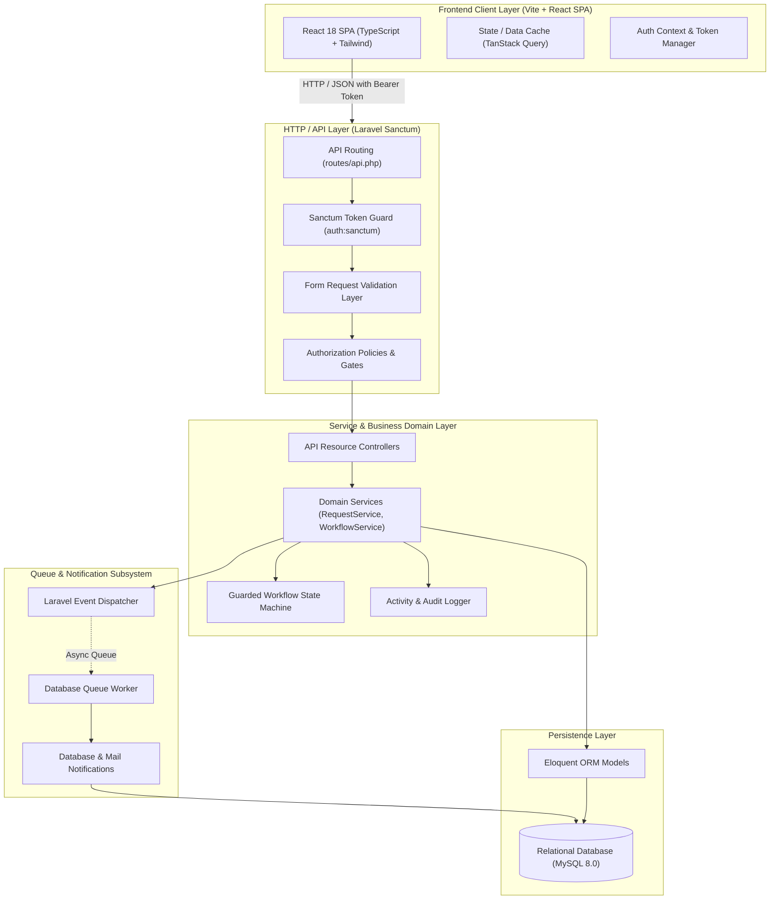
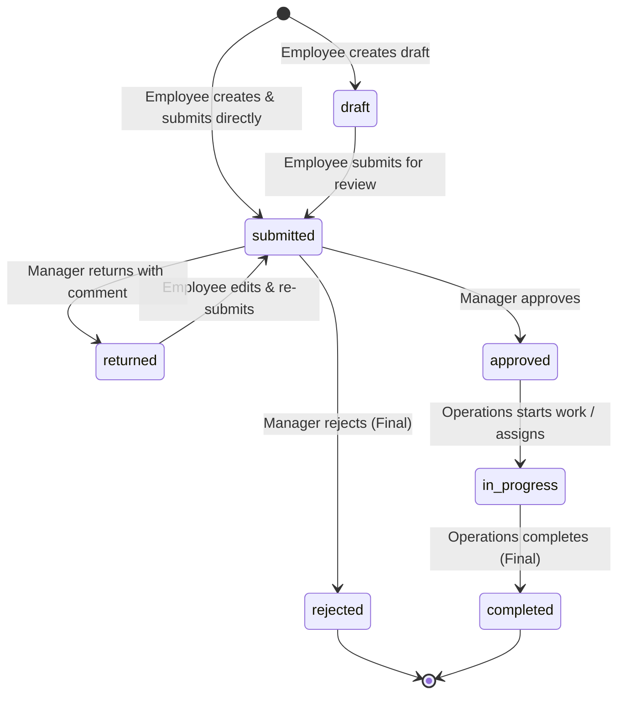
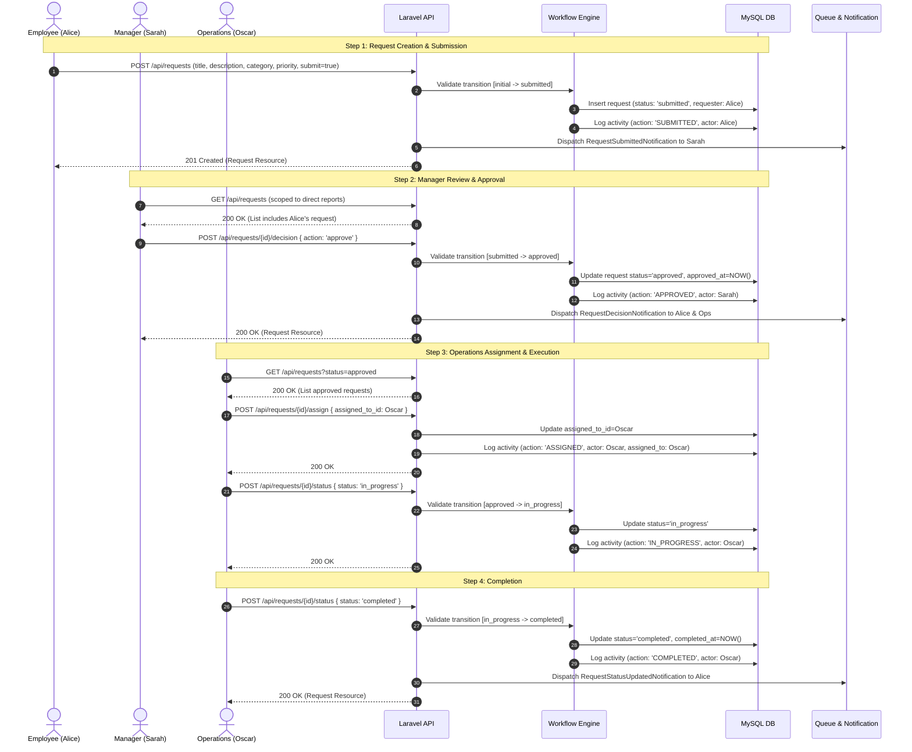
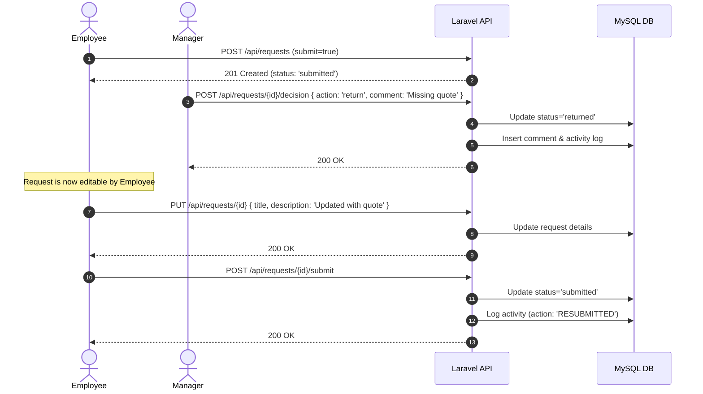

# System Architecture & Technical Specification

## 1. Executive Summary

This document specifies the architectural blueprint for the **Quantix Service Request & Approval Platform**. The system is composed of:
1. **Backend**: A robust **Modular Monolith** built on **Laravel 11+** (PHP 8.2+) with strict Service Layer separation, Form Requests, Sanctum token authentication, Policies, Queued Notifications, and automated Pest/PHPUnit tests.
2. **Frontend**: A dedicated, decoupled **React 18+ SPA** (built with TypeScript, Vite, Tailwind CSS, TanStack React Query, and React Hook Form) consuming the REST API.

---

## 2. High-Level Architectural Diagram



---

## 3. Backend Architecture: Modular Monolith with Service Layer

To avoid the pitfalls of "Fat Controllers" or "Bloated Active Record Models", the Laravel backend employs a clean **Layered Architecture (Modular Monolith)**:

```
app/
├── Http/
│   ├── Controllers/
│   │   ├── Api/
│   │   │   ├── AuthController.php
│   │   │   ├── ServiceRequestController.php
│   │   │   ├── RequestWorkflowController.php
│   │   │   ├── RequestCommentController.php
│   │   │   └── NotificationController.php
│   ├── Requests/
│   │   ├── LoginRequest.php
│   │   ├── StoreServiceRequest.php
│   │   ├── UpdateServiceRequest.php
│   │   ├── WorkflowDecisionRequest.php
│   │   ├── AssignRequest.php
│   │   ├── UpdateStatusRequest.php
│   │   └── StoreCommentRequest.php
│   ├── Resources/
│   │   ├── UserResource.php
│   │   ├── ServiceRequestResource.php
│   │   ├── ServiceRequestListResource.php
│   │   ├── RequestCommentResource.php
│   │   ├── RequestActivityResource.php
│   │   └── NotificationResource.php
│   └── Middleware/
│       └── EnsureUserHasRole.php
├── Models/
│   ├── User.php
│   ├── ServiceRequest.php
│   ├── RequestComment.php
│   └── RequestActivity.php
├── Policies/
│   └── ServiceRequestPolicy.php
├── Services/
│   ├── ServiceRequestService.php
│   ├── WorkflowEngine/
│   │   ├── RequestStateMachine.php
│   │   ├── RequestState.php
│   │   └── Transitions/
│   ├── ActivityLogService.php
│   └── NotificationService.php
├── Events/
│   └── RequestStatusChanged.php
├── Listeners/
│   └── SendStatusChangeNotification.php
└── Notifications/
    ├── RequestSubmittedNotification.php
    ├── RequestDecisionNotification.php
    ├── RequestAssignedNotification.php
    └── RequestStatusUpdatedNotification.php
```

### 3.1. Responsibilities of Architectural Components

| Component | Responsibility | Constraints |
| :--- | :--- | :--- |
| **Controllers** | Orchestrates HTTP request/response flow, invokes Form Requests, calls Service methods, and transforms output via API Resources. | Strictly no database queries, business rules, or status mutations inside controllers. |
| **Form Requests** | Validates inbound HTTP payloads, extracts verified data, and standardizes validation failure responses (HTTP 422). | Reusable rules, no state mutation. |
| **Policies & Gates** | Enforces Role-Based Access Control (RBAC) and object-level permissions (e.g. manager direct reports check). | Throws `403 Forbidden` if user is unauthorized. |
| **Domain Services** | Houses core business logic (`ServiceRequestService`, `ActivityLogService`). Coordinates transactions (`DB::transaction`). | Contains no HTTP/JSON references. |
| **Workflow State Machine** | Strict state transition table ensuring requests advance only along valid paths. Throws `InvalidStateTransitionException` (422) on violations. | Single source of truth for request status lifecycle. |
| **Eloquent Models** | Data access, relationship declarations, query scopes, and property casting. | Clean Active Record models without workflow side-effects. |
| **API Resources** | Serializes models into consistent, predictable JSON responses. Excludes internal hashes and provides formatted timestamps. | All API outputs pass through Resources. |
| **Events & Queues** | Decouples status change side-effects (email, in-app notification) from the synchronous HTTP cycle. | Handled asynchronously via database queue. |

---

## 4. Role-Based Access Control (RBAC) & Authorization

The system enforces three primary roles:
1. **Employee**: Submits requests, edits requests in `draft` or `returned` status, submits requests for review, tracks own requests, adds comments.
2. **Manager**: Reviews requests submitted **only by their own direct reports** (`requester.manager_id == auth.id`), makes decision (`approved`, `rejected`, `returned` with mandatory comment).
3. **Operations**: Views all approved requests across the company, assigns request owners, transitions work to `in_progress`, marks requests `completed`.

### Authorization Implementation:
- **`EnsureUserHasRole` Middleware**: Verifies whether the authenticated user holds one of the required roles before executing routes.
- **`ServiceRequestPolicy`**: Granular method-level authorization:
  - `view(User $user, ServiceRequest $request)`:
    - Employee: only if `$request->requester_id === $user->id`
    - Manager: only if `$request->requester->manager_id === $user->id`
    - Operations: allowed for all requests
  - `update(User $user, ServiceRequest $request)`:
    - Only Employee who created it, AND status is `draft` or `returned`.
  - `submit(User $user, ServiceRequest $request)`:
    - Only Employee who created it, AND status is `draft` or `returned`.
  - `makeDecision(User $user, ServiceRequest $request)`:
    - Only Manager where `$request->requester->manager_id === $user->id`, AND status is `submitted`.
  - `assign(User $user, ServiceRequest $request)`:
    - Only Operations role, AND status is `approved` or `in_progress`.
  - `updateStatus(User $user, ServiceRequest $request)`:
    - Only Operations role, AND status is `approved` or `in_progress`.
  - `addComment(User $user, ServiceRequest $request)`:
    - Requester, Requester's direct Manager, or any Operations staff.

---

## 5. Workflow State Machine & Lifecycle Rules

The lifecycle is modeled using an explicit, guarded state transition table in `App\Services\WorkflowEngine\RequestStateMachine`:



### Transition Matrix & Guard Rules:

| Source Status | Allowed Action | Destination Status | Allowed Role | Mandatory Requirements |
| :--- | :--- | :--- | :--- | :--- |
| `draft` | `submit` | `submitted` | Employee (Owner) | Requester must have an assigned manager |
| `returned` | `submit` | `submitted` | Employee (Owner) | Must have passed validation |
| `submitted` | `approve` | `approved` | Manager (Direct) | Optional approval comment |
| `submitted` | `return` | `returned` | Manager (Direct) | **Mandatory comment explaining reason** |
| `submitted` | `reject` | `rejected` | Manager (Direct) | Optional rejection reason; **Terminal State** |
| `approved` | `assign` | `approved` | Operations | Valid `assigned_to_id` (Operations user) |
| `approved` | `start` | `in_progress` | Operations | Changes status to working |
| `in_progress`| `assign` | `in_progress` | Operations | Re-assigns owner |
| `in_progress`| `complete` | `completed` | Operations | **Terminal State** |

> **Transition Integrity**: Attempting any transition not defined above (e.g. `draft` -> `in_progress` or modifying a `completed`/`rejected` request) immediately aborts the transaction and returns `HTTP 422 Unprocessable Entity` with a descriptive error message.

---

## 6. End-to-End Sequence Diagrams

### 6.1. Complete Happy Path: From Submission to Completion



### 6.2. Return and Re-submission Journey



---

## 7. Audit Trail & Activity Logging Architecture

Every mutation to a `service_requests` row produces an immutable record in `request_activities`:
- Actor User ID (`user_id`)
- Action identifier (`action`)
- Previous status (`from_status`)
- Target status (`to_status`)
- Decision or transition comment (`comment`)
- Contextual metadata (`metadata`: JSON diff of altered fields or assigned user ID)
- Creation timestamp (`created_at`)

Because `request_activities` is append-only, historical records can never be mutated or falsified, guaranteeing compliance with enterprise SaaS audit standards.

---

## 8. Asynchronous Notifications & Queues

When a state transition occurs:
1. `ServiceRequestService` fires a domain event: `RequestStatusChanged`.
2. A queued listener `SendStatusChangeNotification` intercepts the event and determines recipients:
   - Request Submitted -> Notifies direct Manager.
   - Request Returned / Rejected / Approved -> Notifies Requester.
   - Request Approved -> Notifies Operations group.
   - Request Assigned -> Notifies Assigned Operations User & Requester.
   - Request Completed -> Notifies Requester.
3. Notifications are dispatched via Laravel's `Queue` driver (configured as `database` for zero-dependency local execution) and persisted to the `notifications` table.

---

## 9. Performance & Query Optimization Strategy

1. **Eager Loading**: All list queries automatically eager-load `['requester:id,name,email', 'assignedTo:id,name,email']` to eradicate N+1 query bottlenecks.
2. **Selective Column Loading**: List endpoints return summary fields without bloated description texts.
3. **Compound Database Indexes**:
   - `(requester_id, status)` for Employee dashboards.
   - `(status, created_at)` for Operations queues.
   - `(manager_id)` on `users` for fast manager-hierarchy resolution.
4. **Pagination**: All listing endpoints enforce standardized pagination (`page` and `per_page`, capped at 100).
5. **Code Quality & Static Analysis**: Automated formatting with **Laravel Pint** and static analysis with **PHPStan / Larastan** (Level 6+).

