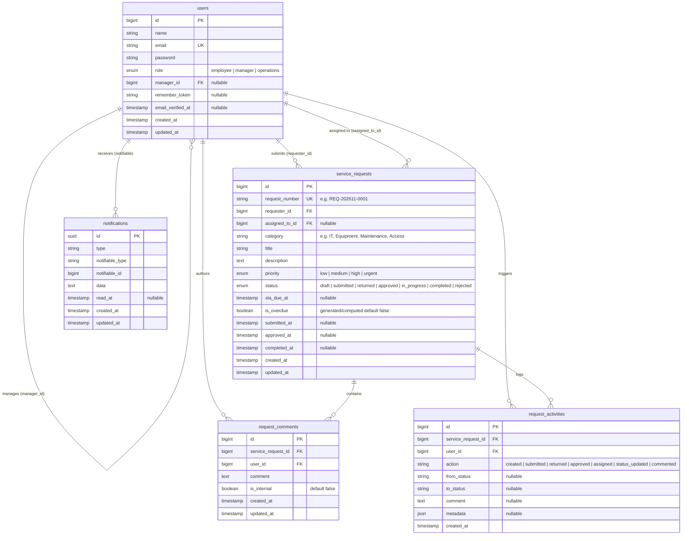

# Database Design & Data Modeling Specification

## 1. Overview & Principles

This document defines the relational database architecture for the **Quantix Service Request & Approval API**. The design strictly adheres to relational integrity, 3rd Normal Form (3NF), database indexing best practices, and Eloquent ORM conventions for Laravel 11+.

### Key Architectural Requirements:
1. **Manager Hierarchy**: Recursive self-referencing relationship on `users` (`manager_id` foreign key referencing `users.id`).
2. **Dual User Relationships on Service Requests**: Explicit separation between the `requester_id` (Employee who submitted the request) and `assigned_to_id` (Operations staff member executing the request).
3. **Audit Trail**: Dedicated `request_activities` table capturing historical state transitions, actor identification, before/after status, and transitional notes.
4. **Collaborative Discourse**: Isolated `request_comments` table enabling contextual threaded communication between valid participants (requester, manager, operations).
5. **Asynchronous Notification Persistence**: Laravel-standard polymorphic `notifications` table to store queued status-change alerts.

---

## 2. Entity-Relationship Diagram (ERD)



---

## 3. Detailed Table Specifications

### 3.1. `users` Table
Stores authentication credentials, user identity, assigned role, and organizational reporting hierarchy.

| Column | Type | Attributes | Nullable | Description / Constraints |
| :--- | :--- | :--- | :--- | :--- |
| `id` | `BIGINT UNSIGNED` | `AUTO_INCREMENT`, `PRIMARY KEY` | No | Unique identifier for user |
| `name` | `VARCHAR(255)` | | No | Full display name |
| `email` | `VARCHAR(255)` | `UNIQUE` | No | Unique login email address |
| `email_verified_at` | `TIMESTAMP` | | Yes | Email verification timestamp |
| `password` | `VARCHAR(255)` | | No | Bcrypt/Argon2 hashed password |
| `role` | `ENUM('employee', 'manager', 'operations')` | `INDEX` | No | Strict role-based enum for authorization |
| `manager_id` | `BIGINT UNSIGNED` | `FOREIGN KEY` | Yes | Points to `users(id)`. Direct manager reference |
| `remember_token` | `VARCHAR(100)` | | Yes | Laravel auth remember token |
| `created_at` | `TIMESTAMP` | | Yes | Creation timestamp |
| `updated_at` | `TIMESTAMP` | | Yes | Last update timestamp |

#### Foreign Keys & Constraints:
- `fk_users_manager_id`: `FOREIGN KEY (manager_id) REFERENCES users(id) ON DELETE SET NULL`
- `chk_users_not_self_manager`: `CHECK (manager_id IS NULL OR manager_id != id)`

#### Indexes:
- `PRIMARY KEY (id)`
- `UNIQUE INDEX idx_users_email (email)`
- `INDEX idx_users_role (role)`
- `INDEX idx_users_manager_id (manager_id)`

---

### 3.2. `service_requests` Table
Core business entity representing internal support, equipment, maintenance, or access service requests.

| Column | Type | Attributes | Nullable | Description / Constraints |
| :--- | :--- | :--- | :--- | :--- |
| `id` | `BIGINT UNSIGNED` | `AUTO_INCREMENT`, `PRIMARY KEY` | No | Primary key |
| `request_number` | `VARCHAR(32)` | `UNIQUE`, `INDEX` | No | Human-readable identifier (e.g. `REQ-202611-0001`) |
| `requester_id` | `BIGINT UNSIGNED` | `FOREIGN KEY`, `INDEX` | No | Submitting Employee (`users.id`) |
| `assigned_to_id`| `BIGINT UNSIGNED` | `FOREIGN KEY`, `INDEX` | Yes | Operations User handling the request (`users.id`) |
| `category` | `VARCHAR(64)` | `INDEX` | No | Request category (e.g., `IT_SUPPORT`, `EQUIPMENT`, `FACILITIES`, `ACCESS`) |
| `title` | `VARCHAR(255)` | | No | Short descriptive title of the request |
| `description` | `TEXT` | | No | Detailed explanation and specifications |
| `priority` | `ENUM('low', 'medium', 'high', 'urgent')` | `DEFAULT 'medium'` | No | Request priority level |
| `status` | `ENUM('draft', 'submitted', 'returned', 'approved', 'in_progress', 'completed', 'rejected')` | `DEFAULT 'draft'`, `INDEX` | No | State machine lifecycle status |
| `sla_due_at` | `TIMESTAMP` | `INDEX` | Yes | Calculated service-level target completion time |
| `is_overdue` | `BOOLEAN` | `DEFAULT FALSE`, `INDEX` | No | Flag indicating overdue SLA status |
| `submitted_at` | `TIMESTAMP` | | Yes | Timestamp of initial or re-submission |
| `approved_at` | `TIMESTAMP` | | Yes | Timestamp of manager approval |
| `completed_at` | `TIMESTAMP` | | Yes | Timestamp of operations completion |
| `created_at` | `TIMESTAMP` | `INDEX` | Yes | Record creation timestamp |
| `updated_at` | `TIMESTAMP` | | Yes | Record modification timestamp |

#### Foreign Keys & Constraints:
- `fk_requests_requester_id`: `FOREIGN KEY (requester_id) REFERENCES users(id) ON DELETE RESTRICT`
- `fk_requests_assigned_to_id`: `FOREIGN KEY (assigned_to_id) REFERENCES users(id) ON DELETE SET NULL`

#### Indexes:
- `PRIMARY KEY (id)`
- `UNIQUE INDEX uidx_service_requests_request_number (request_number)`
- `INDEX idx_service_requests_requester_status (requester_id, status)` (for Employee query optimization)
- `INDEX idx_service_requests_status (status)` (for Operations queue listing)
- `INDEX idx_service_requests_assigned_status (assigned_to_id, status)` (for Operations personal workload)
- `INDEX idx_service_requests_created_at (created_at DESC)` (for pagination sorting)

---

### 3.3. `request_comments` Table
Stores collaborative dialog between the Requester, the reviewing Manager, and Operations staff.

| Column | Type | Attributes | Nullable | Description / Constraints |
| :--- | :--- | :--- | :--- | :--- |
| `id` | `BIGINT UNSIGNED` | `AUTO_INCREMENT`, `PRIMARY KEY` | No | Primary key |
| `service_request_id` | `BIGINT UNSIGNED`| `FOREIGN KEY`, `INDEX` | No | Parent request (`service_requests.id`) |
| `user_id` | `BIGINT UNSIGNED`| `FOREIGN KEY`, `INDEX` | No | Author of comment (`users.id`) |
| `comment` | `TEXT` | | No | Content of the message |
| `is_internal` | `BOOLEAN` | `DEFAULT FALSE` | No | True if note is visible only to Operations/Managers |
| `created_at` | `TIMESTAMP` | | Yes | Timestamp when comment was posted |
| `updated_at` | `TIMESTAMP` | | Yes | Timestamp when comment was updated |

#### Foreign Keys & Constraints:
- `fk_comments_service_request_id`: `FOREIGN KEY (service_request_id) REFERENCES service_requests(id) ON DELETE CASCADE`
- `fk_comments_user_id`: `FOREIGN KEY (user_id) REFERENCES users(id) ON DELETE RESTRICT`

#### Indexes:
- `PRIMARY KEY (id)`
- `INDEX idx_comments_request_created (service_request_id, created_at ASC)` (for chronological timeline query)

---

### 3.4. `request_activities` Table
Immutable audit log recording every transition, status change, reassignment, and formal action on a request.

| Column | Type | Attributes | Nullable | Description / Constraints |
| :--- | :--- | :--- | :--- | :--- |
| `id` | `BIGINT UNSIGNED` | `AUTO_INCREMENT`, `PRIMARY KEY` | No | Primary key |
| `service_request_id` | `BIGINT UNSIGNED`| `FOREIGN KEY`, `INDEX` | No | Related request (`service_requests.id`) |
| `user_id` | `BIGINT UNSIGNED`| `FOREIGN KEY`, `INDEX` | No | Actor responsible for action (`users.id`) |
| `action` | `VARCHAR(64)` | `INDEX` | No | Machine name of action (e.g. `CREATED`, `SUBMITTED`, `RETURNED`, `APPROVED`, `ASSIGNED`, `IN_PROGRESS`, `COMPLETED`, `REJECTED`, `COMMENTED`) |
| `from_status` | `VARCHAR(32)` | | Yes | Status before transition |
| `to_status` | `VARCHAR(32)` | | Yes | Status after transition |
| `comment` | `TEXT` | | Yes | Transition rationale (e.g. manager return reason) |
| `metadata` | `JSON` | | Yes | Optional payload diffs or contextual attributes |
| `created_at` | `TIMESTAMP` | `INDEX` | Yes | Time when the transition occurred |

#### Foreign Keys & Constraints:
- `fk_activities_service_request_id`: `FOREIGN KEY (service_request_id) REFERENCES service_requests(id) ON DELETE CASCADE`
- `fk_activities_user_id`: `FOREIGN KEY (user_id) REFERENCES users(id) ON DELETE RESTRICT`

#### Indexes:
- `PRIMARY KEY (id)`
- `INDEX idx_activities_request_created (service_request_id, created_at ASC)` (for full audit log replay)
- `INDEX idx_activities_user (user_id)` (for auditor lookup by staff member)

---

### 3.5. `notifications` Table (Standard Laravel Schema)
Stores asynchronous in-app notifications generated by queued jobs upon workflow transition events.

| Column | Type | Attributes | Nullable | Description |
| :--- | :--- | :--- | :--- | :--- |
| `id` | `CHAR(36)` | `PRIMARY KEY` (UUID) | No | Notification UUID |
| `type` | `VARCHAR(255)` | | No | Notification class (e.g. `App\Notifications\RequestStatusChanged`) |
| `notifiable_type` | `VARCHAR(255)` | `INDEX` | No | Model class (`App\Models\User`) |
| `notifiable_id` | `BIGINT UNSIGNED` | `INDEX` | No | Target User ID |
| `data` | `TEXT` / `JSON` | | No | Serialized payload (title, message, link, request_id) |
| `read_at` | `TIMESTAMP` | | Yes | Read receipt timestamp |
| `created_at` | `TIMESTAMP` | | Yes | Notification sent time |
| `updated_at` | `TIMESTAMP` | | Yes | Notification update time |

#### Indexes:
- `PRIMARY KEY (id)`
- `INDEX idx_notifications_notifiable (notifiable_type, notifiable_id, read_at)`

---

## 4. Eloquent Model Relationships

### 4.1. `User` Model
```php
namespace App\Models;

use Illuminate\Database\Eloquent\Relations\BelongsTo;
use Illuminate\Database\Eloquent\Relations\HasMany;
use Illuminate\Foundation\Auth\User as Authenticatable;
use Laravel\Sanctum\HasApiTokens;

class User extends Authenticatable
{
    use HasApiTokens;

    protected $fillable = ['name', 'email', 'password', 'role', 'manager_id'];
    protected $hidden = ['password', 'remember_token'];

    // Direct manager
    public function manager(): BelongsTo
    {
        return $this->belongsTo(User::class, 'manager_id');
    }

    // Direct reports (employees reporting to this manager)
    public function directReports(): HasMany
    {
        return $this->hasMany(User::class, 'manager_id');
    }

    // Service requests submitted by this employee
    public function submittedRequests(): HasMany
    {
        return $this->hasMany(ServiceRequest::class, 'requester_id');
    }

    // Service requests assigned to this operations user
    public function assignedRequests(): HasMany
    {
        return $this->hasMany(ServiceRequest::class, 'assigned_to_id');
    }

    // Comments authored by this user
    public function comments(): HasMany
    {
        return $this->hasMany(RequestComment::class);
    }

    // Activities triggered by this user
    public function activities(): HasMany
    {
        return $this->hasMany(RequestActivity::class);
    }

    // Role helper methods
    public function isEmployee(): bool { return $this->role === 'employee'; }
    public function isManager(): bool { return $this->role === 'manager'; }
    public function isOperations(): bool { return $this->role === 'operations'; }
}
```

### 4.2. `ServiceRequest` Model
```php
namespace App\Models;

use Illuminate\Database\Eloquent\Model;
use Illuminate\Database\Eloquent\Relations\BelongsTo;
use Illuminate\Database\Eloquent\Relations\HasMany;

class ServiceRequest extends Model
{
    protected $fillable = [
        'request_number',
        'requester_id',
        'assigned_to_id',
        'category',
        'title',
        'description',
        'priority',
        'status',
        'sla_due_at',
        'is_overdue',
        'submitted_at',
        'approved_at',
        'completed_at',
    ];

    protected $casts = [
        'sla_due_at' => 'datetime',
        'is_overdue' => 'boolean',
        'submitted_at' => 'datetime',
        'approved_at' => 'datetime',
        'completed_at' => 'datetime',
    ];

    public function requester(): BelongsTo
    {
        return $this->belongsTo(User::class, 'requester_id');
    }

    public function assignedTo(): BelongsTo
    {
        return $this->belongsTo(User::class, 'assigned_to_id');
    }

    public function comments(): HasMany
    {
        return $this->hasMany(RequestComment::class)->latest();
    }

    public function activities(): HasMany
    {
        return $this->hasMany(RequestActivity::class)->oldest();
    }
}
```

### 4.3. `RequestComment` Model
```php
namespace App\Models;

use Illuminate\Database\Eloquent\Model;
use Illuminate\Database\Eloquent\Relations\BelongsTo;

class RequestComment extends Model
{
    protected $fillable = [
        'service_request_id',
        'user_id',
        'comment',
        'is_internal',
    ];

    protected $casts = [
        'is_internal' => 'boolean',
    ];

    public function serviceRequest(): BelongsTo
    {
        return $this->belongsTo(ServiceRequest::class);
    }

    public function user(): BelongsTo
    {
        return $this->belongsTo(User::class);
    }
}
```

### 4.4. `RequestActivity` Model
```php
namespace App\Models;

use Illuminate\Database\Eloquent\Model;
use Illuminate\Database\Eloquent\Relations\BelongsTo;

class RequestActivity extends Model
{
    public const UPDATED_AT = null; // Immutable audit log, no updated_at

    protected $fillable = [
        'service_request_id',
        'user_id',
        'action',
        'from_status',
        'to_status',
        'comment',
        'metadata',
    ];

    protected $casts = [
        'metadata' => 'array',
    ];

    public function serviceRequest(): BelongsTo
    {
        return $this->belongsTo(ServiceRequest::class);
    }

    public function user(): BelongsTo
    {
        return $this->belongsTo(User::class);
    }
}
```

---

## 5. Seed Strategy & Sample Data Matrix

As mandated by the assignment brief, a dedicated seeder (`DatabaseSeeder`) will provision deterministic test users and realistic requests across all lifecycle stages.

### 5.1. Seeded Users Table

| Role | Name | Email | Password | Reports To |
| :--- | :--- | :--- | :--- | :--- |
| **Manager** | Sarah Connor (Engineering Lead) | `sarah.manager@quantix.io` | `password` | `NULL` |
| **Employee 1** | Alice Smith (Software Engineer) | `alice.dev@quantix.io` | `password` | Sarah Connor |
| **Employee 2** | Bob Jones (QA Engineer) | `bob.qa@quantix.io` | `password` | Sarah Connor |
| **Employee 3** | Charlie Brown (External Dept) | `charlie.ext@quantix.io` | `password` | `NULL` (Different manager) |
| **Operations 1** | Oscar Martinez (IT SysAdmin) | `oscar.ops@quantix.io` | `password` | `NULL` |
| **Operations 2** | Olivia Vance (DevOps Engineer) | `olivia.ops@quantix.io` | `password` | `NULL` |

### 5.2. Seeded Requests Distribution (10 Sample Requests)

| Request # | Requester | Assigned To | Status | Category | Title | Comments / Audit Trail |
| :--- | :--- | :--- | :--- | :--- | :--- | :--- |
| `REQ-202611-0001` | Alice Smith | `NULL` | `draft` | Equipment | Second monitor for development | Initial draft created |
| `REQ-202611-0002` | Alice Smith | `NULL` | `submitted` | Access | AWS Production read-only access | Submitted to Sarah Connor |
| `REQ-202611-0003` | Alice Smith | `NULL` | `returned` | IT Support | IntelliJ IDEA Ultimate License | Returned by Sarah: "Please add project billing code" |
| `REQ-202611-0004` | Alice Smith | `NULL` | `approved` | Equipment | Ergonomic keyboard & wrist rest | Approved by Sarah, awaiting Ops assignment |
| `REQ-202611-0005` | Alice Smith | Oscar Martinez | `in_progress` | Maintenance | Office desk Ethernet port fix | Assigned to Oscar, work in progress |
| `REQ-202611-0006` | Alice Smith | Oscar Martinez | `completed` | Access | GitHub Organization invite | Completed by Oscar |
| `REQ-202611-0007` | Bob Jones | `NULL` | `submitted` | Equipment | Mobile test devices (iPhone & Pixel) | Submitted to Sarah Connor |
| `REQ-202611-0008` | Bob Jones | `NULL` | `rejected` | Equipment | Personal gaming laptop for testing | Rejected by Sarah: "Policy does not cover personal hardware" |
| `REQ-202611-0009` | Bob Jones | Olivia Vance | `in_progress` | IT Support | Docker desktop licensing configuration | Assigned to Olivia, in progress |
| `REQ-202611-0010` | Charlie Brown | `NULL` | `submitted` | Facilities | Replacement badge keycard | Submitted by non-report (verifies 403 test for Sarah) |

---

## 6. Database Migration Sequencing

Migrations are ordered deterministically to satisfy foreign key dependencies:

1. `2026_11_10_000001_create_users_table.php` (Includes `role` and `manager_id` self-reference)
2. `2026_11_10_000002_create_personal_access_tokens_table.php` (Laravel Sanctum standard)
3. `2026_11_10_000003_create_service_requests_table.php` (Includes `requester_id`, `assigned_to_id`, statuses, SLA fields)
4. `2026_11_10_000004_create_request_comments_table.php`
5. `2026_11_10_000005_create_request_activities_table.php`
6. `2026_11_10_000006_create_notifications_table.php` (Standard database notification queue table)
7. `2026_11_10_000007_create_failed_jobs_table.php` / `create_jobs_table.php` (For background queued emails/notifications)

